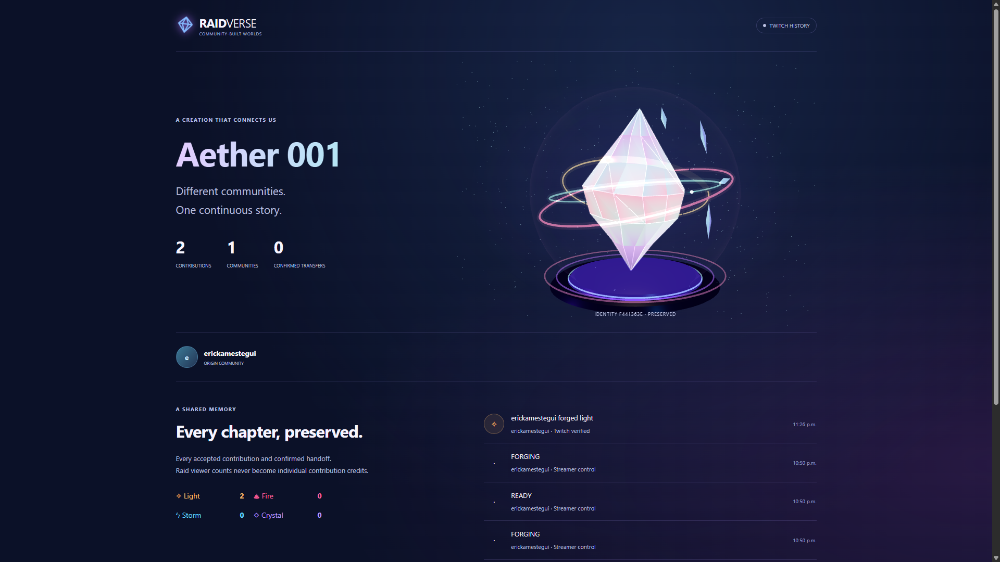

# RAIDVERSE

**Raids move viewers. RAIDVERSE carries what they create.**

A new local-first Twitch experience built with Codex. A persistent, deterministic energy artifact evolves through four chat commands, crosses communities only after a verified raid and receiver approval, and keeps a public legacy.

## Status — authentic Twitch chat verified; real handoff and OBS pending

Genuine OAuth and enabled EventSub chat/raid subscriptions have been verified for one Twitch channel. Two authentic chat contributions are persisted in Aether 001; the latest message was traced through acceptance, SQLite and WebSocket revision 52, and the user confirmed the visible counter changed from 1 to 2. The public legacy displays both accepted contributions. **An authentic two-channel raid, receiver evolution and native OBS handoff remain unverified.** Rehearsal never counts as LIVE evidence.

The current automated suite has **66 passing tests**; TypeScript and production build pass. The build retains a large-bundle advisory. A runtime dependency audit found zero known vulnerabilities at the November 1 Bolivia checkpoint; it is not a security certification. See [the evidence ledger](output/live/README.md), [progress](docs/PROGRESS.md), [judge instructions](docs/JUDGES.md) and [limitations](docs/SUBMISSION.md).



*Actual persisted LIVE state in Chromium. Two-channel raid and native OBS verification remain pending; earlier output/playwright captures are synthetic rehearsal material.*

## What is implemented

- Four deterministic chat transformations: `!forge light`, `!forge fire`, `!forge storm`, `!forge crystal`.
- Owner-controlled rounds; user cooldowns and limits; explicitly enabled moderator safety commands.
- Prepared transfers gated by a matching raid and receiver approval; rejection, cancellation, expiry and duplicate protection.
- SQLite identity, contributions, community lineage and transfer history preserved across restart.
- Transparent OBS renderer with a procedural portal; private read-only viewing keys, rotation and emergency clear.
- Streamer dashboard, legacy archive and shareable legacy route. Internet sharing requires hosting.
- Real Twitch OAuth/Helix/EventSub adapter and isolated, visibly synthetic rehearsal routes.
- Automated domain, HTTP/security and Twitch protocol-fixture tests.

## Development

Node.js 24+. On Windows PowerShell use `npm.cmd` if execution policy blocks `npm.ps1`.

```powershell
npm.cmd install
if (-not (Test-Path -LiteralPath '.env')) { Copy-Item -LiteralPath '.env.example' -Destination '.env' }
npm.cmd run dev
```

Open http://localhost:3000. No paid AI service is used at runtime.

For a reproducible clean install, use `npm.cmd ci` with the included lockfile. If port 3000 is occupied, stop your existing RAIDVERSE instance or set PORT and APP_ORIGIN together and register the matching OAuth callback. Node's built-in SQLite avoids a native database package installation.

```powershell
npm.cmd test
npm.cmd run build
npm.cmd start
```

`start` serves the production frontend with the same Node backend. Build before starting it. Use the exact APP_ORIGIN URL; Host/Origin checks intentionally reject a different hostname.

For a normal Windows terminal that remains independent of an assistant turn, run
`.\Start-RAIDVERSE.cmd` in this repository and keep the terminal open. See
[local startup](docs/LOCAL-STARTUP.md). A second Node server is not needed.

## Twitch setup

Create an application in https://dev.twitch.tv/console/apps with OAuth redirect URL **http://localhost:3000/auth/callback** and confidential client type. Save its client ID and client secret only in `.env`. Never paste secrets into chat or commit them. Each broadcaster authorizes independently in a separate browser profile. Two real channels and a real raid are required to validate the core LIVE flow.

1. Restart after saving local credentials. Click **Connect with Twitch** in profile A and authorize A, then repeat for B in another profile.
2. Each broadcaster enables RAIDVERSE and allows incoming invitations as desired. Create an artifact in A and begin a round.
3. Send one of the exact commands from authentic Twitch chat. Observe the count, visual and verified contribution record.
4. End A's round, select B and prepare the transfer. Perform the actual raid through Twitch.
5. B sees the incoming invitation and accepts. The same artifact arrives. B can start its own evolution round.
6. Open its legacy and check the same artifact ID. Never replace a missing real event with a synthetic one.

Only `user:read:chat` is requested. No permission to initiate raids, send chat, change broadcasts or manipulate OBS is requested. Details and official references: [architecture](docs/ARCHITECTURE.md).

Follow [the independent-session receiver checklist](docs/SECOND-CHANNEL.md) before
the real handoff. Two tabs in one normal browser profile share a session. B's OBS
source must already be active when B accepts; the portal follows the arrival time.

## Rehearsal walkthrough

Click **Enter rehearsal** to create two clearly labeled synthetic channels, ORBITAL and NOVA, and an empty artifact. Begin a round, select synthetic viewers and forge the four elements. Cooldowns still apply. End the round, prepare NOVA, click **Simulate raid**, then explicitly accept in NOVA. Begin evolution and contribute again. All those records remain synthetic, including the overlay and public legacy. Live and rehearsal artifacts cannot cross modes.

## OBS setup

Select your channel → Stream setup → Generate overlay URL. Add that private URL to an OBS Browser Source at 1920×1080 or 1280×720. The page has an alpha background. Keep it active during the handoff. The receiver adds their own source; a raid never changes their OBS scene. **Clear overlay** blanks the source on its next safety poll. **Restore** reveals it. Disable pauses participation and blanks the source. Keep the viewing URL private and rotate it if exposed.

## Data and security

The server binds to 127.0.0.1 by default. Data lives in ignored `data/`, including the SQLite database and AES-GCM vault key. Keep this directory private using Windows permissions and back up the database **together with its original key**. Losing the key means the stored Twitch tokens cannot be decrypted. No secrets belong in `VITE_` variables. Do not share `.env`, `data/`, browser storage exports or proxy logs.

The public legacy intentionally contains display names, contributions, times and provenance. The public state contains no Twitch tokens, sessions or overlay keys. The local demonstration is not an audited hosted service. See [architecture](docs/ARCHITECTURE.md) for remote hosting and capacity limitations.

## Validation and submission

- Automated: `npm.cmd test` (temporary databases and local fixtures; no Twitch accounts required).
- TypeScript + production bundle: `npm.cmd run build`.
- Manual LIVE checklist and English Devpost/video draft: [submission preparation](docs/SUBMISSION.md).
- Executed browser steps: `scripts/qa/`; captures: `output/playwright/`. The optional CLI wrapper handles Windows argument quoting. Browser QA needs Playwright CLI and an installed Chromium browser; it is separate from `npm test`.
- No external deployment, repository publication, YouTube upload or Devpost submission has occurred.

## Project record

- Principal Codex session: `01a18894-cb84-7530-8113-1b14124a414e`
- Created from an empty workspace on October 29, 2026.
- Not submitted, published, or deployed.
